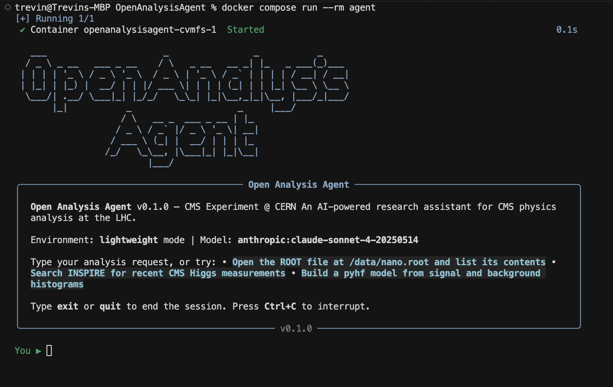

# OpenAnalysisAgent

**An open-source agentic research framework for CMS physics analysis.**

Built on LangChain Deep Agents with tools for ROOT I/O, INSPIRE-HEP, pyhf, CMSSW, and end-to-end collider workflows. Pip-installable core, with full MadGraph/Pythia/ROOT via Docker + CVMFS.

[](https://opensource.org/licenses/MIT)
[](https://doi.org/10.5281/zenodo.XXXXXXX)



---

## Table of Contents

- [Overview](#overview)
- [Architecture](#architecture)
- [Installation](#installation)
- [Quick Start](#quick-start)
- [Tools Reference](#tools-reference)
- [Docker + CVMFS Environment](#docker--cvmfs-environment)
- [CMSSW Integration](#cmssw-integration)
- [Configuration](#configuration)
- [Examples](#examples)
- [Roadmap](#roadmap)
- [Contributing](#contributing)
- [Citation](#citation)
- [License](#license)

---

## Overview

OpenAnalysisAgent is an AI-powered research assistant purpose-built for CMS experiment data analysis at the Large Hadron Collider. It uses LangChain Deep Agents to provide an autonomous agent that can plan, execute, and iterate on complex multi-step analysis workflows — from querying datasets and reading ROOT files to running statistical inference and producing publication-quality plots.

The agent understands CMS-specific concepts: NanoAOD and MiniAOD data formats, CMSSW configuration, DAS dataset queries, global tag selection, and the Scikit-HEP ecosystem. It can decompose high-level physics questions ("measure the Z boson pT spectrum in Run 2 data") into concrete analysis steps and execute them.

### Why OpenAnalysisAgent?

The typical CMS analysis workflow involves coordinating dozens of tools — uproot for I/O, awkward-array for columnar data, hist for histogramming, pyhf for statistical inference, mplhep for plotting, CMSSW for reconstruction, DAS for data discovery — each with its own API, configuration format, and quirks. OpenAnalysisAgent wraps all of these into a unified agentic interface where a researcher can describe what they want in natural language and the agent handles the orchestration.

### Design Principles

- **CMS-first**: Every tool, prompt, and default is optimized for CMS analysis workflows. Not experiment-agnostic by design.
- **Lightweight core**: The pip-installable package depends only on pure-Python libraries (uproot, pyhf, awkward-array). No C++ ROOT dependency required.
- **Full stack via Docker**: A single `docker compose up` gives you the complete HEP software stack (ROOT, MadGraph, Pythia, Delphes, CMSSW) backed by CVMFS, with OpenAnalysisAgent on top.
- **Human-in-the-loop**: The agent pauses for researcher approval at critical steps — cut definitions, fit configurations, unblinding. It assists, it does not replace.
- **Never fabricate physics**: The system prompt enforces that the agent cannot invent cross-sections, fake data, or hallucinate results. Every number must come from a computation or a source.
- **Reproducible**: Every agent action, tool call, and intermediate artifact is logged with metadata. Analysis workflows are replayable.

---

## Architecture

OpenAnalysisAgent is built on the [LangChain Deep Agents](https://github.com/langchain-ai/deepagents) framework, which provides four core primitives:

```
┌──────────────────────────────────────────────────┐
│                 OpenAnalysisAgent                │
├──────────────────────────────────────────────────┤
│                                                  │
│   Planning Tool         Subagent Spawning        │
│   ─ Decomposes          ─ Delegates tasks        │
│     analysis tasks        to isolated            │
│     into subtasks         subagents              │
│                                                  │
│   Filesystem Context    System Prompt            │
│   ─ Reads/writes        ─ CMS-specific           │
│     intermediate          domain knowledge       │
│     results               and constraints        │
│                                                  │
├──────────────────────────────────────────────────┤
│              CMS Tool Suite                      │
│                                                  │
│   Data I/O    │  Literature  │  Analysis         │
│   ─ ROOT      │  ─ INSPIRE   │  ─ Event sel.     │
│   ─ NanoAOD   │  ─ arXiv     │  ─ Kinematics     │
│   ─ LHE/HepMC │  ─ HEPData  │  ─ Histograms      │
│   ─ DAS query │  ─ PDG       │  ─ Jet clustering │
│               │              │                   │
│   Stats       │  Simulation  │  Visualization    │
│   ─ pyhf      │  ─ MadGraph  │  ─ mplhep         │
│   ─ cabinetry │  ─ Pythia    │  ─ Ratio panels   │
│   ─ CLs/sig.  │  ─ CMSSW     │  ─ Brazil band    │
│               │  ─ Delphes   │                   │
├──────────────────────────────────────────────────┤
│   LangChain Deep Agents  │  LangGraph Runtime    │
└──────────────────────────────────────────────────┘
```

### Tool Categories

The agent has access to domain-specific tools organized into six categories. Each tool is a LangChain `@tool`-decorated function with type annotations, docstrings, and structured error handling. The agent selects and invokes tools based on its plan.

---

## Installation

### Core (pip)

The lightweight core installs with pip and has no C++ dependencies:

```bash
pip install openanalysisagent
```

This gives you:

- ROOT file I/O via uproot
- Awkward-array for columnar CMS data
- pyhf and cabinetry for statistical inference
- INSPIRE-HEP and arXiv search tools
- PDG particle data lookups
- mplhep for CMS-style plots
- DAS dataset query tools
- The full Deep Agents framework

### Full Stack (Docker + CVMFS)

For the complete environment including MadGraph, Pythia, ROOT, Delphes, and CMSSW:

```bash
git clone https://github.com/trevin-lee/open-analysis-agent.git
cd OpenAnalysisAgent
docker compose up
```

The Docker setup mounts CVMFS repositories to provide the full CMS software stack without any manual installation. Requires Docker with the following capabilities:

- `SYS_ADMIN` capability (for FUSE mounts)
- `/dev/fuse` device access
- Shared volume mount at `/cvmfs`

### Environment Variables

Create a `.env` file in the project root:

```bash
# Required: at least one LLM provider
ANTHROPIC_API_KEY=sk-ant-...
# or
OPENAI_API_KEY=sk-...

# Optional: for web search capabilities
TAVILY_API_KEY=tvly-...

# Optional: CMS-specific
CMSSW_VERSION=CMSSW_14_2_0
SCRAM_ARCH=el9_amd64_gcc12
```

### Requirements

- Python >= 3.10
- Docker (for full stack only)
- An API key for at least one supported LLM provider (Anthropic, OpenAI, Groq, or any provider supported by LangChain's `init_chat_model`)

---

## Quick Start

### Basic Usage

```python
from openanalysisagent import create_cms_agent

# Create an agent with default CMS tools
agent = create_cms_agent(
    model="anthropic:claude-sonnet-4-20250514",
)

# Run a simple analysis query
result = agent.invoke({
    "messages": [
        {
            "role": "user",
            "content": "Open the NanoAOD file at /data/nano.root, plot the muon pT distribution for events with exactly two muons, and apply CMS style formatting."
        }
    ]
})
```

### With Custom Tools

```python
from openanalysisagent import create_cms_agent
from langchain_core.tools import tool

@tool
def my_custom_cut(pt_threshold: float) -> str:
    """Apply a custom pT threshold cut to the current event selection."""
    # your implementation
    ...

agent = create_cms_agent(
    model="anthropic:claude-sonnet-4-20250514",
    tools=[my_custom_cut],
    system_prompt="You are analyzing H→WW events. Always apply lepton isolation cuts.",
)
```

### Using a Different Model

```python
from openanalysisagent import create_cms_agent

# Use any model supported by LangChain
agent = create_cms_agent(model="openai:gpt-4o")
agent = create_cms_agent(model="groq:llama-3.3-70b-versatile")
```

---

## Tools Reference

### Data I/O Tools

#### `list_root_contents`
Opens a ROOT file and lists all objects (TTrees, TH1s, TDirectories) with their types.

```
Parameters:
  filepath (str): Path to the .root file or xrootd URL

Returns:
  str: Formatted list of object names and class types
```

#### `read_root_branches`
Reads specified branches from a TTree and returns summary statistics or raw arrays.

```
Parameters:
  filepath (str): Path to the ROOT file
  tree_name (str): Name of the TTree
  branches (list[str]): Branch names to read
  max_entries (int): Maximum number of entries to read (default: 10000)
  library (str): Output library — "np" for NumPy, "ak" for Awkward (default: "ak")

Returns:
  str: Summary statistics (count, mean, std, min, max) for each branch
```

#### `read_nanoaod`
Reads CMS NanoAOD files with awareness of NanoAOD branch naming conventions (Muon_pt, Electron_eta, Jet_phi, etc.).

```
Parameters:
  filepath (str): Path to NanoAOD ROOT file
  collections (list[str]): NanoAOD collections to read (e.g., ["Muon", "Electron", "Jet"])
  cuts (str, optional): Selection string in NanoAOD syntax
  max_entries (int): Maximum events to process (default: 100000)

Returns:
  str: Summary of loaded collections with entry counts and branch statistics
```

#### `query_das`
Queries the CMS Data Aggregation System (DAS) for datasets, files, runs, and luminosity information.

```
Parameters:
  query (str): DAS query string (e.g., "dataset=/ZeroBias/Run2024A-*/NANOAOD")
  limit (int): Maximum number of results (default: 50)

Returns:
  str: Formatted DAS query results
```

#### `convert_format`
Converts between HEP file formats.

```
Parameters:
  input_path (str): Path to input file
  output_path (str): Path for output file
  input_format (str): Source format — "root", "parquet", "csv", "hdf5"
  output_format (str): Target format — "root", "parquet", "csv", "hdf5"
  tree_name (str, optional): TTree name for ROOT files

Returns:
  str: Confirmation with output file path and entry count
```

### Literature & Knowledge Tools

#### `search_inspire`
Searches the INSPIRE-HEP database for papers by topic, author, collaboration, or arXiv ID.

```
Parameters:
  query (str): INSPIRE search query
  sort (str): Sort order — "mostrecent", "mostcited" (default: "mostrecent")
  max_results (int): Maximum results to return (default: 10)

Returns:
  str: Formatted list with titles, authors, arXiv IDs, citation counts, and DOIs
```

#### `get_bibtex`
Retrieves BibTeX entries from INSPIRE-HEP for one or more papers.

```
Parameters:
  identifiers (list[str]): List of INSPIRE record IDs or arXiv IDs

Returns:
  str: BibTeX entries for all requested papers
```

#### `search_arxiv`
Searches arXiv for preprints by query, author, or category.

```
Parameters:
  query (str): Search query
  category (str, optional): arXiv category filter (e.g., "hep-ex", "hep-ph")
  max_results (int): Maximum results (default: 10)

Returns:
  str: Formatted list with titles, authors, abstracts, and arXiv IDs
```

#### `query_hepdata`
Retrieves published data tables from HEPData for a given INSPIRE record.

```
Parameters:
  inspire_id (str): INSPIRE record ID
  table_name (str, optional): Specific table to retrieve

Returns:
  str: Data table contents with column names, units, and values
```

#### `lookup_particle`
Looks up particle properties from the PDG database.

```
Parameters:
  name (str): Particle name (e.g., "W+", "Z0", "H", "top", "muon")

Returns:
  str: Mass, width, lifetime, quantum numbers, and dominant decay modes
```

### Analysis Tools

#### `apply_event_selection`
Applies cuts to event data and returns the surviving events with efficiency.

```
Parameters:
  filepath (str): Path to ROOT/NanoAOD file
  tree_name (str): TTree name
  cuts (dict): Dictionary of branch_name: (operator, value) pairs
  
Returns:
  str: Number of events before/after cuts, efficiency, and cut flow table
```

#### `compute_invariant_mass`
Computes invariant mass from particle four-momenta.

```
Parameters:
  pt (list): Transverse momentum arrays for each particle
  eta (list): Pseudorapidity arrays
  phi (list): Azimuthal angle arrays
  mass (list): Particle mass arrays

Returns:
  str: Invariant mass array summary statistics and histogram data
```

#### `compute_delta_r`
Computes ΔR = √(Δη² + Δφ²) between particle pairs.

```
Parameters:
  eta1 (array): η values for first particle collection
  phi1 (array): φ values for first particle collection
  eta2 (array): η values for second particle collection
  phi2 (array): φ values for second particle collection

Returns:
  str: ΔR values summary and distribution
```

#### `fill_histogram`
Creates and fills histograms from array data using boost-histogram.

```
Parameters:
  data (array): Data to histogram
  bins (int): Number of bins (default: 50)
  range (tuple, optional): (min, max) range
  weights (array, optional): Event weights
  label (str, optional): Histogram label

Returns:
  str: Histogram bin edges, contents, and statistics (mean, std, integral)
```

### Statistical Inference Tools

#### `build_pyhf_model`
Constructs a pyhf HistFactory workspace from signal, background, and observed data histograms.

```
Parameters:
  signal (list[float]): Signal histogram bin contents
  background (list[float]): Background histogram bin contents
  observed (list[float]): Observed data bin contents
  signal_uncertainty (list[float], optional): Signal systematic uncertainties
  background_uncertainty (list[float], optional): Background systematic uncertainties

Returns:
  str: Workspace summary and validation status
```

#### `run_cls_limit`
Computes CLs upper limits on the signal strength parameter.

```
Parameters:
  workspace (dict): pyhf workspace JSON
  cl (float): Confidence level (default: 0.95)
  poi_values (list[float], optional): Parameter of interest scan points

Returns:
  str: Observed and expected upper limits with ±1σ and ±2σ bands
```

#### `run_discovery_test`
Computes discovery significance (p-value and significance in σ).

```
Parameters:
  workspace (dict): pyhf workspace JSON

Returns:
  str: Observed p-value and significance, expected significance
```

#### `run_fit`
Performs a maximum likelihood fit using pyhf.

```
Parameters:
  workspace (dict): pyhf workspace JSON

Returns:
  str: Best-fit parameter values, uncertainties, correlation matrix, and fit status
```

#### `build_cabinetry_workspace`
Constructs a cabinetry workspace from a declarative YAML configuration.

```
Parameters:
  config_path (str): Path to cabinetry YAML configuration file

Returns:
  str: Workspace summary with regions, samples, and systematics
```

### Visualization Tools

#### `plot_distribution`
Creates a publication-quality distribution plot with CMS style formatting.

```
Parameters:
  histograms (list[dict]): List of histogram data (bin_edges, contents, label, color)
  xlabel (str): X-axis label with units
  ylabel (str): Y-axis label (default: "Events")
  title (str, optional): Plot title
  cms_label (str): CMS label — "Preliminary", "Supplementary", "Private Work" (default: "Private Work")
  lumi (float, optional): Integrated luminosity in fb⁻¹
  sqrt_s (float): Center-of-mass energy in TeV (default: 13.6)
  ratio_panel (bool): Include a ratio panel (default: False)
  output_path (str): Path to save the figure

Returns:
  str: Confirmation with output path
```

#### `plot_brazil_band`
Creates a CLs limit plot with expected and observed limits (Brazil band).

```
Parameters:
  poi_values (list[float]): Scanned parameter of interest values
  observed (list[float]): Observed CLs values
  expected (list[float]): Expected (median) CLs values
  expected_1sigma (tuple): (down, up) ±1σ expected bands
  expected_2sigma (tuple): (down, up) ±2σ expected bands
  xlabel (str): X-axis label
  output_path (str): Path to save the figure

Returns:
  str: Confirmation with output path and observed/expected limit values
```

#### `plot_pull`
Creates nuisance parameter pull plots from fit results.

```
Parameters:
  parameter_names (list[str]): Names of nuisance parameters
  pulls (list[float]): Pull values (best-fit - nominal) / σ
  constraints (list[float]): Post-fit constraint values
  output_path (str): Path to save the figure

Returns:
  str: Confirmation with output path
```

### CMSSW Tools

#### `setup_cmssw`
Sets up a CMSSW working environment.

```
Parameters:
  version (str): CMSSW version (e.g., "CMSSW_14_2_0")
  scram_arch (str, optional): Architecture string (auto-detected if not provided)
  workdir (str, optional): Working directory path

Returns:
  str: Confirmation with CMSSW environment details
```

#### `run_cmsrun`
Executes a cmsRun job with the given configuration file.

```
Parameters:
  config_path (str): Path to the CMSSW Python configuration file
  num_events (int, optional): Number of events to process (-1 for all)
  num_threads (int, optional): Number of threads

Returns:
  str: Job summary with exit code, output files, and processing statistics
```

#### `generate_cmsrun_config`
Generates a CMSSW Python configuration file from high-level parameters.

```
Parameters:
  process_name (str): Process name (e.g., "ANALYSIS")
  input_files (list[str]): Input file paths or DAS dataset names
  global_tag (str): Conditions global tag
  output_file (str, optional): Output ROOT file path
  max_events (int): Maximum events to process (default: -1)

Returns:
  str: Generated configuration file path and contents summary
```

#### `query_global_tag`
Recommends the correct global tag for a given dataset and era.

```
Parameters:
  dataset (str): Dataset name or DAS path
  data_type (str): "data" or "mc"
  era (str, optional): Data-taking era (e.g., "Run2024A")

Returns:
  str: Recommended global tag with explanation
```

---

## Docker + CVMFS Environment

The Docker environment provides the full CMS software stack without requiring any local installation beyond Docker itself.

### docker-compose.yml

```yaml
version: '3.8'

services:
  cvmfs:
    image: cvmfs/service:2.12.0-1
    cap_add:
      - SYS_ADMIN
    devices:
      - /dev/fuse
    environment:
      - CVMFS_CLIENT_PROFILE=single
      - CVMFS_REPOSITORIES=cms.cern.ch,sft.cern.ch
      - CVMFS_HTTP_PROXY=DIRECT
    volumes:
      - cvmfs:/cvmfs:shared

  agent:
    build: .
    depends_on:
      - cvmfs
    volumes:
      - cvmfs:/cvmfs:ro
      - ./workspace:/workspace
    env_file:
      - .env
    ports:
      - "8888:8888"  # Jupyter
      - "2024:2024"  # LangGraph API

volumes:
  cvmfs:
    driver: local
```

### Dockerfile

```dockerfile
FROM python:3.12-slim

WORKDIR /app

# Install system dependencies
RUN apt-get update && apt-get install -y \
    git \
    curl \
    && rm -rf /var/lib/apt/lists/*

# Install OpenAnalysisAgent
COPY . .
RUN pip install -e ".[full]"

# Default entrypoint
CMD ["python", "-m", "openanalysisagent.serve"]
```

### Environment Detection

The agent automatically detects the available environment and adapts its capabilities:

```python
from openanalysisagent.environment import detect_environment

env = detect_environment()
# Returns:
# {
#     "cvmfs": True,
#     "cmssw": "/cvmfs/cms.cern.ch",
#     "cmssw_version": "CMSSW_14_2_0",
#     "scram_arch": "el9_amd64_gcc12",
#     "madgraph": "/cvmfs/cms.cern.ch/.../MG5_aMC",
#     "pythia": True,
#     "root": "/cvmfs/sft.cern.ch/.../root",
#     "mode": "full"   # or "lightweight" if no CVMFS
# }
```

When running in lightweight mode (pip-only), tools that require CVMFS (CMSSW, MadGraph, Pythia, compiled ROOT) are disabled, and the agent informs the user which capabilities are unavailable and how to enable them.

---

## CMSSW Integration

OpenAnalysisAgent can set up, configure, and run CMSSW jobs. This requires the Docker + CVMFS environment.

### Automatic Environment Setup

```python
from openanalysisagent import create_cms_agent

agent = create_cms_agent(
    model="anthropic:claude-sonnet-4-20250514",
    cmssw_version="CMSSW_14_2_0",
)

result = agent.invoke({
    "messages": [{
        "role": "user",
        "content": "Set up CMSSW, create a simple EDAnalyzer that reads MiniAOD and plots the leading muon pT."
    }]
})
```

### What the Agent Handles

- Selecting the correct `SCRAM_ARCH` for the OS and CMSSW version
- Sourcing the CMS environment from CVMFS (`/cvmfs/cms.cern.ch/cmsset_default.sh`)
- Running `cmsrel` and `cmsenv`
- Generating CMSSW Python configuration files
- Selecting the appropriate global tag for a dataset and era
- Running `cmsRun` and parsing output
- Querying DAS for datasets and file locations

---

## Configuration

### Agent Configuration

OpenAnalysisAgent can be configured via a YAML file:

```yaml
# openanalysisagent.yml

model:
  provider: anthropic
  name: claude-sonnet-4-20250514
  temperature: 0

environment:
  cmssw_version: CMSSW_14_2_0
  scram_arch: el9_amd64_gcc12
  default_data_dir: /workspace/data
  default_output_dir: /workspace/output

analysis:
  default_cms_label: "Private Work"
  default_sqrt_s: 13.6
  default_lumi: null
  blinding: true

agent:
  max_iterations: 50
  human_approval_steps:
    - cut_definition
    - fit_configuration
    - unblinding
  log_level: INFO
  artifact_dir: /workspace/artifacts
```

### Blinding Support

The agent respects blinding conventions. When `blinding: true` is set:

- The agent will not look at data in the signal region until explicitly unblinded
- Unblinding requires human approval via the human-in-the-loop checkpoint
- Background-only fits and expected limits can be computed without unblinding

---

## Examples

### Example 1: Z → μμ Invariant Mass

```python
result = agent.invoke({
    "messages": [{
        "role": "user",
        "content": """
        Using the NanoAOD file at /data/DoubleMuon_Run2018A.root:
        1. Select events with exactly 2 muons with pT > 20 GeV and |eta| < 2.4
        2. Require opposite-sign muon pairs
        3. Compute the dimuon invariant mass
        4. Plot the invariant mass spectrum from 60 to 120 GeV
        5. Use CMS Private Work style with 2018 luminosity
        """
    }]
})
```

### Example 2: Setting Upper Limits

```python
result = agent.invoke({
    "messages": [{
        "role": "user",
        "content": """
        I have signal and background histograms for a BSM search:
        - Signal: [0.5, 1.2, 2.1, 1.8, 0.9, 0.3]
        - Background: [50, 120, 200, 180, 95, 40]
        - Observed: [48, 118, 205, 176, 98, 38]
        - Background uncertainty: 10% correlated normalization
        
        Build a pyhf model, compute the expected and observed 95% CLs upper limit
        on the signal strength, and make a Brazil band plot.
        """
    }]
})
```

### Example 3: Literature Search

```python
result = agent.invoke({
    "messages": [{
        "role": "user",
        "content": """
        Search INSPIRE for the most cited CMS papers on Higgs boson measurements
        from the last 2 years. Get BibTeX entries for the top 5 results.
        """
    }]
})
```

### Example 4: Full CMSSW Workflow

```python
result = agent.invoke({
    "messages": [{
        "role": "user",
        "content": """
        Set up CMSSW_14_2_0. Find the latest Run2024A SingleMuon NanoAOD dataset
        on DAS. Determine the correct global tag. Create a cmsRun config to 
        process 10000 events and produce a flat ntuple with muon kinematics.
        """
    }]
})
```

---

## Roadmap

### v0.1.0 — MVP
- Core ROOT I/O tools (uproot-based)
- NanoAOD reader with CMS collection awareness
- INSPIRE-HEP and arXiv search tools
- PDG particle data lookups
- Basic event selection and kinematics
- Histogram filling and manipulation
- pyhf statistical inference (CLs limits, discovery significance, fits)
- mplhep CMS-style plotting
- Deep Agents integration with planning and filesystem context
- CITATION.cff and Zenodo DOI

### v0.2.0 — CMSSW & Infrastructure
- CMSSW setup and cmsRun execution tools
- DAS dataset query tools
- Global tag recommendation
- Docker + CVMFS environment
- Configuration file generation
- Human-in-the-loop approval checkpoints

### v0.3.0 — Simulation & Advanced Analysis
- MadGraph interface (process cards, run cards, event generation)
- Pythia showering and hadronization
- Delphes fast detector simulation
- cabinetry workspace construction
- Systematic uncertainty handling
- Cut flow optimization

### v0.4.0 — Collaboration & Publishing
- CRAB grid job submission
- Analysis preservation (REANA/Snakemake export)
- Automatic AN/PAS draft generation
- Jupyter notebook export of analysis workflows
- MCP server support for Claude Code / Claude Desktop integration

---

## Contributing

Contributions are welcome. Please read the following guidelines before submitting a pull request.

### Development Setup

```bash
git clone https://github.com/trevin-lee/open-analysis-agent.git
cd OpenAnalysisAgent
pip install -e ".[dev]"
```

### Running Tests

```bash
# Unit tests (no CVMFS required)
pytest tests/ -m "not integration"

# Integration tests (requires Docker + CVMFS)
pytest tests/ -m integration

# Skip slow simulation tests
pytest tests/ --skip-slow
```

### Code Style

- Follow PEP 8
- Type annotations on all public functions
- Docstrings on all tools (the agent reads these)
- Tests for all new tools

### Adding a New Tool

1. Create a new file in `openanalysisagent/tools/`
2. Decorate the function with `@tool` from `langchain_core.tools`
3. Write a clear docstring — the LLM uses this to understand when and how to call the tool
4. Add type annotations to all parameters
5. Return a string (the agent reads tool outputs as text)
6. Add the tool to the appropriate tool list in `openanalysisagent/agent.py`
7. Write tests in `tests/tools/`

---

## Citation

If you use OpenAnalysisAgent in your research, please cite:

```bibtex
@software{openanalysisagent,
  author       = {Trevin Lee},
  title        = {{OpenAnalysisAgent: An Agentic Research Framework for CMS Physics Analysis}},
  year         = {2026},
  publisher    = {Zenodo},
  doi          = {10.5281/zenodo.XXXXXXX},
  url          = {https://github.com/trevin-lee/open-analysis-agent}
}
```

### CITATION.cff

```yaml
cff-version: 1.2.0
message: "If you use this software, please cite it as below."
title: "OpenAnalysisAgent"
abstract: "An open-source agentic research framework for CMS physics analysis."
authors:
  - family-names: "Lee"
    given-names: "Trevin"
    orcid: "https://orcid.org/0000-0000-0000-0000"
version: 0.1.0
doi: 10.5281/zenodo.XXXXXXX
date-released: 2026-01-01
license: MIT
repository-code: "https://github.com/trevin-lee/open-analysis-agent"
keywords:
  - high-energy-physics
  - CMS
  - particle-physics
  - AI-agent
  - deep-agents
  - ROOT
  - pyhf
  - LHC
```

---

## License

MIT License

Copyright (c) 2026 Trevin Lee

Permission is hereby granted, free of charge, to any person obtaining a copy
of this software and associated documentation files (the "Software"), to deal
in the Software without restriction, including without limitation the rights
to use, copy, modify, merge, publish, distribute, sublicense, and/or sell
copies of the Software, and to permit persons to whom the Software is
furnished to do so, subject to the following conditions:

The above copyright notice and this permission notice shall be included in all
copies or substantial portions of the Software.

THE SOFTWARE IS PROVIDED "AS IS", WITHOUT WARRANTY OF ANY KIND, EXPRESS OR
IMPLIED, INCLUDING BUT NOT LIMITED TO THE WARRANTIES OF MERCHANTABILITY,
FITNESS FOR A PARTICULAR PURPOSE AND NONINFRINGEMENT. IN NO EVENT SHALL THE
AUTHORS OR COPYRIGHT HOLDERS BE LIABLE FOR ANY CLAIM, DAMAGES OR OTHER
LIABILITY, WHETHER IN AN ACTION OF CONTRACT, TORT OR OTHERWISE, ARISING FROM,
OUT OF OR IN CONNECTION WITH THE SOFTWARE OR THE USE OR OTHER DEALINGS IN THE
SOFTWARE.